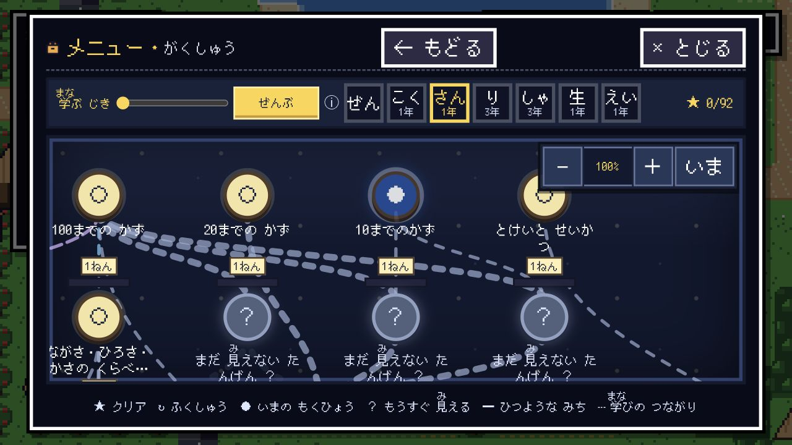

# 学習スキルツリー Walkthrough

## 変更概要

従来の蛇行する一本道ロードマップを、単元の前提関係に従って分岐・合流する学習スキルツリーへ変更した。ノード数に表示上限は設けていない。

## 画面で確認できること

1. 「がくしゅう」を開くと、最初に全教科の進捗カードが表示される。
2. 教科を選ぶと、暗い地図の上に単元ノードと前提関係の線が表示される。
3. 挑戦できる単元は押して問題を開始できる。
4. 一段先は「？」と「まだ見えない単元」で示し、本当の単元名は表示・読み上げともに隠す。
5. それより遠い領域は霧と位置だけを示し、学習が進むと次の範囲が明るくなる。
6. 一度身につけた単元で復習時期が来たら、隠さず「↻」の復習ノードとして表示する。
7. 上部の「学ぶ時期」バーで、全体または小学1年1学期〜6年3学期を連続して選べる。時期未設定の単元は該当学年の各学期で表示される。
8. `−`、`＋`、倍率表示、`いま`を使って60〜160%へ拡大縮小し、現在のおすすめ単元へ戻せる。
9. パソコンではドラッグと2本指スクロール、Ctrl／Command＋トラックパッド、スマートフォンでは1本指ドラッグと2本指ピンチで地図を動かせる。
10. 実線は解除に必要な前提、色付きの点線は構成・転移・関連・時系列の補助線として表示される。
11. ロック中の単元は「さきに：○○」で、先に身につける単元を示す。
12. 既存セーブで導入前にクリア済みだった単元は、初回ロード時に既得進捗として保持し、新しい概念判定で再ロックしない。

## 実装の境界

- 前提関係の正: `content/curriculum/`
- 集約・解放・霧・配置: `src/scenes/overworld/roadmap.ts`
- SVG接続線と操作ノード: `src/ui/field/RoadmapGraph.tsx`
- 教科・学年・時期フィルタ: `src/ui/field/RoadmapView.tsx`
- ズーム・パン・ピンチ操作: `src/ui/field/RoadmapGraph.tsx`

## データ状況

2026-10-23時点の正式課程280単元は、すべて少なくとも1本の学習関係へ接続済み。全関係は文部科学省の各教科学習指導要領解説を一次資料とし、ゲーム上の解除条件に使う `prerequisite` と、解除を妨げない補助関係を分けた。

| 教科 | 単元 | 表示線 | 必須線 | 分岐 | 合流 | AND合流 | 孤立 |
| --- | ---: | ---: | ---: | ---: | ---: | ---: | ---: |
| 算数 | 90 | 118 | 54 | 32 | 33 | 15 | 0 |
| 国語 | 87 | 99 | 34 | 19 | 12 | 2 | 0 |
| 生活 | 12 | 14 | 0 | 3 | 3 | 0 | 0 |
| 理科 | 51 | 53 | 16 | 8 | 6 | 2 | 0 |
| 社会 | 28 | 34 | 3 | 6 | 4 | 0 | 0 |
| 英語 | 12 | 16 | 5 | 2 | 6 | 1 | 0 |

統合監査では、重複、必須線と補助線の重なり、教科横断表示線、逆学年ハード線、表示循環、必須循環、未確認・出典なしの表示線がすべて0件。373件の関係は `source-checked` であり、これは一次資料との照合済みを表すが、教員による `expert-reviewed` ではない。

## 検査

- 単元グラフ、AND解放、段階可視性、決定論的配置のユニットテスト
- ロードマップの単元選択、ロック、接続線、霧名称の非開示、時期バー、ズーム、トラックパッドのテスト
- 全134テストファイル、1426テストが成功
- TypeScript型検査、依存境界検査、教材検査、ビルド
- 実ブラウザで表示、60%ズーム、ドラッグ、現在地復帰、ロック理由を確認
- 1280×720、844×390、640×360で確認。ページ全体の横はみ出しは0
- 小1・2の教科列は「国語・算数・生活科」、小3〜6は一文字表示で、いずれも教科列の横スクロールは0
- 正規プレビュー: `http://127.0.0.1:4174/`
- 独立エージェントによる最終コードレビュー: ブロッカー0件

## 残る監修作業

- 教科書会社で配列が変わる同学年内の `chronological` を教員が確認する。
- 理科・英語の必須線と算数・国語のAND合流が、対象児童の実態に対して過剰なロックにならないか確認する。
- 国語4年の教材固有に見える既存単元名、国語6年の汎用的な概念説明を優先確認する。
- 教科横断線は単一教科表示では見えないため現版には含めていない。将来追加する場合は、境界ノードまたは複数教科表示の設計と合わせて教員が確認する。
