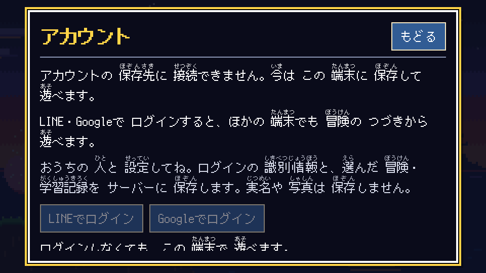
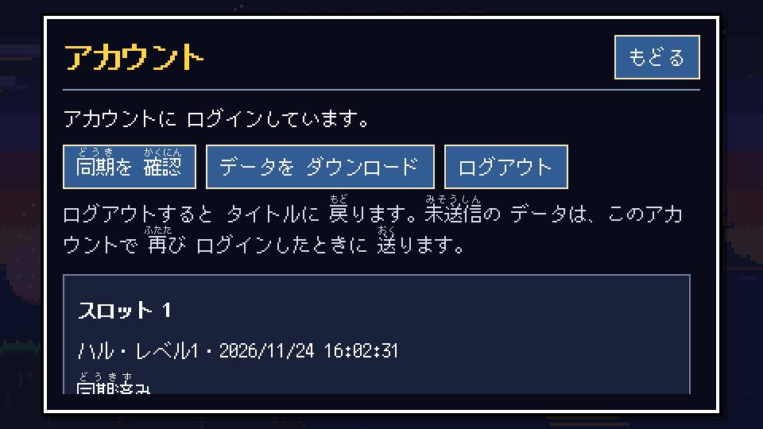

# アカウント保存の実装・検証記録

ブランチ: `codex/account-cloud-save-20261124`。基点: `391e0e83`（統合HEAD `6bec298b` を含む）。共有ブランチへの merge／push は未実施。

実装コミット `dfe7fe64` 後、統合HEAD `6b47e4a4` を通常mergeした `8688c1d7` でも check:fast、全件test、buildを再実行して成功。ViteのAPI proxy設定を既存server設定へ集約し、本番CSPで遮断されていた起動計測を外部スクリプトへ移動した。

## 実装

- LINE／Google の任意ログイン、ゲストデータの確認付き引き継ぎ、3スロットのアカウント保存。
- PostgreSQL の所有者照合、revision の競合制御、再送ID、削除マーカー、レート制限。
- 端末内のゲスト／アカウント分離、バックアップ、通信断時の送信待ちと復帰後の再送。
- アカウント画面での競合解決、JSONダウンロード、ログアウト、再認証を要求するアカウント削除。
- 複数タブの上書きを Web Locks で防止。起動リトライは認証完了と所有者一致を確認。
- Service Worker は API と no-store をキャッシュせず、古いキャッシュ版を更新時に除去。
- Node の同一 origin 配信、DB migration、環境変数例、`docs/ACCOUNT_SETUP.md`。

## 検証

- `pnpm check:fast`: lint、依存境界、アプリ／サーバーの型検査成功。
- `pnpm exec tsc -p tsconfig.tests.json --noEmit`: テストコードの型検査成功。
- `pnpm test`: 299ファイル・2654件すべて成功。
- `pnpm build`: コンテンツ検証、schema・manifest生成、型検査、本番ビルド成功。
- `account-cloud-save.spec.ts`: 実ブラウザで3件成功。未設定状態、確認して引き継ぎ、別ブラウザ復元、同一ブラウザ複数タブ制限、ログアウト、遅延認証時の起動リトライを確認。
- SQL はテスト専用PGliteで実行し、所有者分離・同時更新・重複再送・削除の挙動を確認。
- Better Auth のテスト用アダプターで各providerの開始URL、OpenIDのみのscope、state、PKCE、不正callback拒否を確認。
- 所有者チェックを反転するmutationで5件が失敗し、元へ戻すと7件成功。認可テストが実際の防御を検知することを確認。
- 別エージェントのレビュー指摘（複数タブ、未来版、proxy IP、リトライ）を修正し、最終レビューでブロッカーなし。
- Graphifyはローカルのコード抽出のみ。外部LLMは未使用。
- 4177の専用作業プレビューをアプリ内ブラウザで開き、アカウント画面の表示と戻る操作を確認。4174の既存正規サーバーは変更していない。
- 最終修正後も check:fast、テスト型検査、build成功。Node本番配信（8789）のCSP下で上記ブラウザ3件を再実行して成功。844×390でもログイン・戻る操作が表示範囲に収まり、起動時のpageerrorがないことを確認。画面の下部はスクロール可能。
- 未登録のユーザー向けにDB作成、Google・LINE登録、環境変数、初回復元確認、設定エラーの対処を手順書へ追記。管理コンソールでの実登録は未実施。

## 画面

資格情報がないときは、ログイン済みのように見せずボタンを無効化する。

APIを模擬したブラウザテストで、引き継ぎ後のアカウント保存を確認した画面。

## 残る設定と検証

Google側の専用プロジェクト `causal-temple-515714-n6`（NIHON QUEST）を作成。外部ブラウザ経由でclient secretを取り出す方法は自動承認レビューで拒否されたため、Googleから直接取得したJSONを端末内で取り込む `scripts/import-google-oauth.mjs` を追加した。callback完全一致、既存設定の上書き拒否、秘密値を出力しないこと、0600権限、再実行を5件のテストで確認。lint、architecture、アプリ・サーバー・テストの型検査が成功。architecture実行はサンドボックスのIPC制限に当たったため、許可された環境で再実行した。実際のclient secretはまだ取り込んでいない。

2026-11-24追記: この専用worktreeのローカルDBをDocker Composeで準備した。`nq-account-local-db-1`、独立ボリューム、localhostの55439番を使用。アプリ用 `nq_app` は非superuser・DB作成不可・ロール作成不可。`.env` は0600・Git除外で生成し、秘密値は出力していない。migration初回と再実行が成功。実PostgreSQLに対して保存・再送・競合・所有者分離・cascade削除を検証し、テストtransactionはrollbackした。DB接続済みAPIは session=200（userId=null、providers=[]）、未認証slots=401を確認。検証用APIは停止し、DBは再利用用に保持する。

次はGoogle・LINEのクライアント登録後、このworktreeの `.env` へID/secretを設定する。DBと認証秘密鍵のローカル準備は完了しているため、再生成は不要。本番DB・公開先は別途必要。

LINE Loginチャネル、本番PostgreSQL、本番公開先は未設定。Googleのclient secretは下記2026-11-25の追加作業で設定済み。実際の外部アカウントの本人認証と本番DBでの復元は未検証。APIを模擬するE2Eは実ログイン検証を代替しない。次は `docs/ACCOUNT_SETUP.md` に沿って登録情報を安全に設定し、両プロバイダーの実アカウントで検証する。

運用バックアップ保持期間、削除後の復元時の扱い、期限切れ認証行の定期保守は公開先で設定する。

依存監査: critical/high は0件。Vite 6.4.4 の開発サーバーに moderate 1件（GHSA-8g5g-mxqh-grgj、修正版6.4.5）。既存のVite版で、新しい認証SDKのテスト用peer経路でも検出される。Node本番配信はViteサーバーを起動せず、開発サーバーは127.0.0.1に限定。開発基盤の更新時に解消する（再確認日: 2026-12-01）。

2026-11-25: Google同意アプリの作成をユーザー承認後に確定。専用project `causal-temple-515714-n6` にWebクライアント `NIHON QUEST local development` が存在し、callback `http://127.0.0.1:4177/api/auth/callback/google` とExternal/Testing設定を確認。client IDだけを端末の.envへ反映。client secretは取得していない。テストユーザー登録はツール結果で確証が得られず、必要時の確認が残る。実OAuth往復とLINE登録は未完了。

2026-11-25追加: ユーザーがTinyFish経由の秘密鍵取得・端末保存と、同一開発クライアントへの新しい鍵1件の追加を明示承認。Googleの処理待ち解消後に1件追加し、秘密値をチャット本文へ出さずローカルimportスクリプトで.envへ保存した。既存鍵は削除していない。.envはGit除外・0600を確認。実APIでGoogle provider有効、callback一致、openid scope、state/PKCE/HttpOnly cookieを検証。実ブラウザでGoogleボタン有効・LINEボタン無効、Googleへの遷移を確認（google-ready.png）。本人ログイン後のcallback成功とデータ復元はまだ未確認。API8789・作業プレビュー4177は本人確認の引き継ぎ用に起動し、4174は変更していない。LINE DevelopersのTinyFish接続は本人ログイン待ち。
