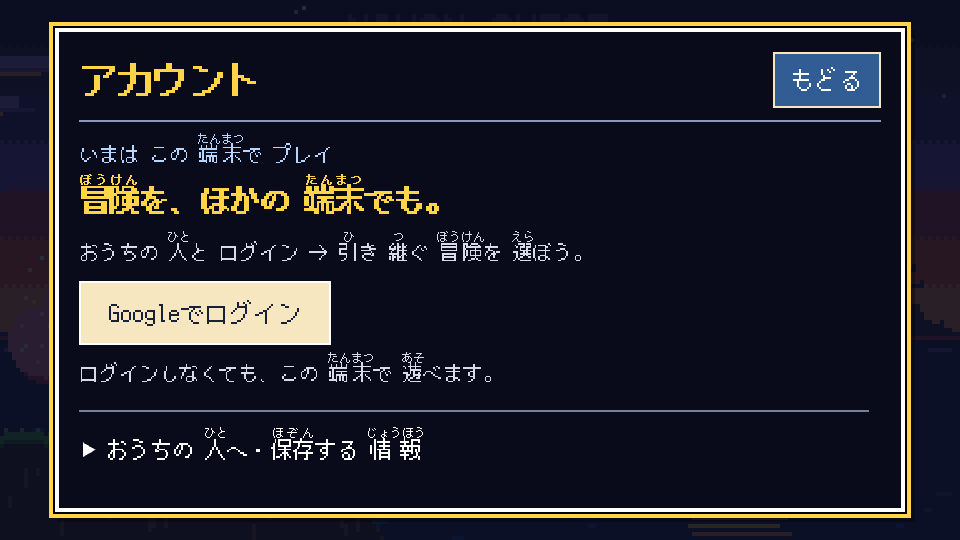
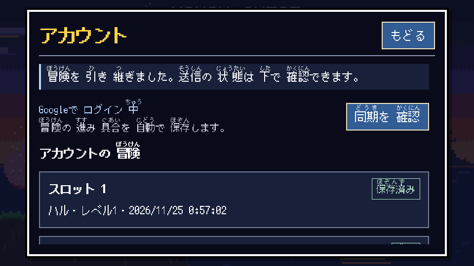
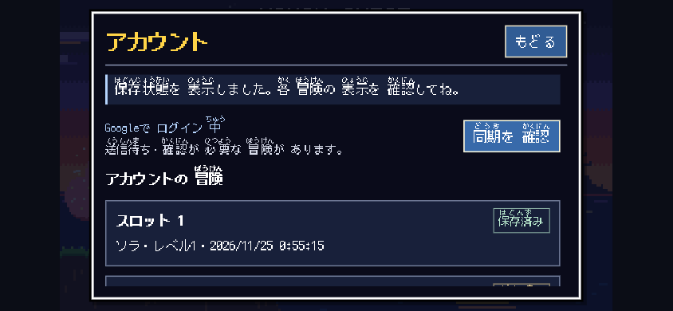

# アカウント画面の改善（2026-11-25）

## 変更

- Googleログインを主操作として強調し、保護者向けの保存情報を折りたたみ表示にした。
- 初回ログインでアカウントに冒険がない場合は、端末の冒険の引き継ぎを最初に表示する。
- 冒険ごとに「保存済み」「送信待ち」「確認が必要」「空き」を文字付きバッジで区別する。
- ダウンロード・ログアウト・削除を「アカウントの管理」にまとめた。
- 競合データの置き換えと、未送信データがある場合のログアウトに確認を追加した。
- 確認では「やめる」に初期フォーカスを置き、Escでキャンセルして操作元へ戻る。折りたたみ操作もダイアログのTab移動に含める。
- 重複リクエストを防ぎ、操作ごとに失敗案内を表示する。処理結果は画面上部へ出し、未送信データを送信完了と表示しない。

認証方式・サーバーの認可・保存形式・アカウント所有者の判定は変更していない。依存追加なし。

## 検証

- `pnpm build`：コンテンツ検証、型チェック、本番バンドル生成に成功。
- 表示調整後の引き継ぎE2Eも再実行し成功。
- `pnpm check:fast`：lint、設計境界、アプリ・サーバーの型チェック成功。
- アカウント保存・API・認証・Service Workerの関連ユニットテスト：20件成功。
- `pnpm exec tsc -p tsconfig.tests.json --noEmit`：成功。
- ChromeのアカウントE2E：5件成功。未設定時のゲスト継続、引き継ぎ、別ブラウザ復元、複数タブの保護、認証待ち、Google接続失敗の再試行、競合キャンセル・確定、未送信ログアウト、削除エラーを確認。
- 回帰テスト自体の検証：ブラウザ内だけで未送信ログアウトの条件を反転すると、確認画面の検査が失敗することを確認。作業ファイルは変更していない。
- 960×540と844×390で実際に描画し、画像を目視確認。ログイン画面とスクロール可能な保存一覧で横方向のはみ出しがないことを確認。

## 画面

## 確認先と残る範囲

作業版は http://127.0.0.1:4177/?account=1 。Codex右側ブラウザにも開いた。
Google本人認証を伴う実アカウントのログイン完了は今回の自動検証に含まない。認証・保存の画面遷移は模擬APIで検証した。
共有統合ブランチ・正規プレビュー4174・本番への反映は行っていない。全件の `pnpm test` / `check:full` は統合担当のゲートとし、この作業では関連検査を実行した。
