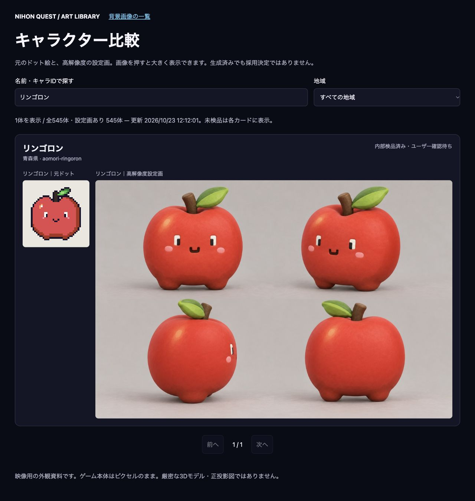
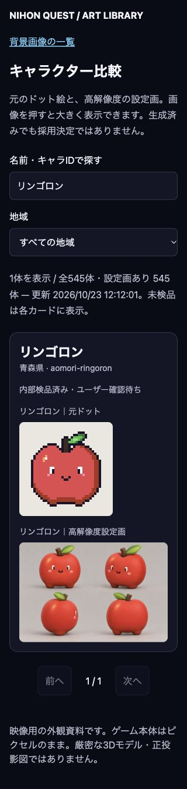

# アート資料サイト・画像制作結果

更新：2026-10-23。

## 作成物

- 残り通常モンスター338体を生成・原本保存。内蔵image_gen使用。全プロンプトは `docs/cinematics/NATIONWIDE_MONSTER_TURNAROUNDS_V9_REQUEST.json`、保存・寸法・ハッシュは同 `V9_STATUS.json`、個別の生成元は各体のgeneration-recordsへ保存。
- 原本：`assets/cinematics/monsters/nationwide-turnarounds-v9/`。公開用JPEGは原本とは別。元PNGの上書きなし。
- 通常モンスターは既存200＋今回338＋御三家の既存採用3＝541 ID分。旧データ1 IDは別。人物4人を合わせてサイト設定画545件・元ドット543件。シオリとカナエの専用元ドットはないことを明示。
- 既存背景65枚を保持し、比較ページと相互に移動可能。名前／ID検索、地域選択、12件単位のページ切り替え、画像リンクによる拡大を用意。

## 公開結果

- URL：https://nihon-quest-art-library.imamurakouma623.chatgpt.site
- 所有者限定。一般公開に変更していない。
- Sites project：`appgprj_6ad9e52667948191966446e66e6c55ce`
- deployment：`appgdep_6adad648de74819185414e1669d83d21`、状態 `succeeded`。
- version：`appgprj_6ad9e52667948191966446e66e6c55ce~appgver_95d8d143e1b08191843cf9d32622f6cb`
- 公開ソース：独立サイトの `main`、コミット `92b4bf221e9ea287bd57c7cc8aa97673cb787081`。`sites/nihon-quest-art-library/` のみをSitesヘルパーで保存・送信した。
- 元ゲーム側：`codex/ui-polish-next`、基点 `d3570f30e67fdbfc910679f9c9786b731f31d9ef`。大量の既存変更を保持し、一括コミット・マージ・ユーザーのGitHubリモートへのpushをしていない。

## 確認したこと

- `node --test sites/nihon-quest-art-library/tests/catalog.test.mjs`：4件成功。地域一致条件を反転すると該当テストが失敗し、元へ戻すと4件成功することを確認。
- `node --check`：app/buildの構文成功。対象HTML/JS/テストのPrettier検査成功。
- 新規338枚はすべて1536×1024、ID重複なし、入力参照あり。以前の選定100体はSHA-256一致・変更なし。
- サイト545件の設定画・543件の元ドットの参照ファイル欠落なし。サイト生成時のチェックに成功。
- 実ブラウザ：リンゴロン検索、0件表示、青森の絞り込み、背景一覧への移動、キー操作での次／前ページ、検索から地域へのTab移動を確認。
- 320pxと768pxでdocument幅がviewport幅を超えない。768pxとデスクトップで比較2画像のロードを確認。320pxの全体スクリーンショットも保存。
- ローカル比較ページのコンソールerror/warnは確認時0件。
- Graphifyの既存グラフ照会では今回の資料HTMLは対象ノード外。ゲーム側の依存に新しい接続を追加していない。外部LLMによる意味付けは使用しない。
- ゲーム本体・配信カタログを変更していないため、ゲームのmanifest再生成や全体build/testはこの独立資料サイト工程では実行していない。

## 表示確認画像

## 残課題と制限

- 全338体と前100体の全件目視検品・本番採用は未完了。ページ内でも生成済みと採用済みを区別する。生成枚数を品質承認数と見なさない。
- 公開版の認証後表示は未確認。アプリ内ブラウザでChatGPTログインが400エラーとなり、再試行後は認証サービスのセキュリティ検証待ち。検証を回避せずユーザーへ引き継ぐ。Sites配信成功とは区別する。
- ローカル確認URL：`http://127.0.0.1:4175/`。確認用サーバーを残している。統合ゲームプレビュー4174には触れていない。
- 既存の御三家進化6形態、魔王覚醒、汎用NPCの全形態・人物棚卸しは通常541 IDとは別。今回の全通常モンスター生成完了を、これらすべての完成とは扱わない。
- サイト再生成は現在のゲームチェックアウトの採用資料を読む。独立Sitesリポジトリ単体から全原本を再生成できる構成にはしていない。公開アーカイブには表示用素材をすべて含む。
