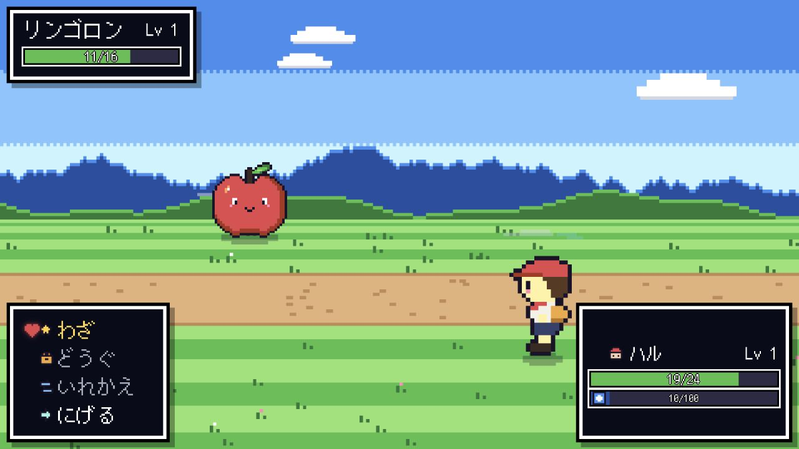

# Battle presentation runtime walkthrough

## 実装内容

- `BattleEvent` を型付きの表示 command に変換し、イベント境界を越えて順番を崩さない
  `BattlePresentationRuntime` を追加した。
- queue、active task、cancel、dispose、port failure、二重完了防止、cleanup-once を
  Phaser 非依存の契約として分離した。
- fast-forward / skip は自動待機だけを短縮し、テキスト確認、視覚演出、音、
  HP・勝敗・乱数などのゲームロジックは省略しない。
- `Battle.ts` の独自 `playing` / `chain` / `play` を runtime へ置き換え、
  shutdown と error recovery を同じ cleanup 経路へ統一した。
- `BattleEvent` の視覚演出を `eventAnimator.ts` へ抽出し、`Battle.ts` を
  1,730 行から 1,577 行へ縮小した。
- HeartGold のコード、素材、画面構成は参照・転用していない。

## 確認方法

### 自動検査

以下をすべて成功させた。

```bash
pnpm exec vitest run tests/unit/battlePresentationRuntime.test.ts
pnpm exec tsc --noEmit
env E2E_PORT=4175 pnpm test:e2e:battle
pnpm lint
pnpm check:architecture
pnpm test
pnpm validate:content
pnpm build
graphify update . --force --no-cluster
```

- Runtime unit: 9 tests passed
- Battle E2E: 24 tests passed
- Full unit/integration: 1,465 tests passed in 138 files
- Graphify: code-only graph rebuilt without semantic labeling or an external LLM
- Mutation check: `TALK_FIRST` の分岐を意図的に反転すると対象テストが失敗することを確認し、
  復元後に再度 green を確認した。

### 実ブラウザ

最新版の production build を `127.0.0.1:4175` で起動し、アプリ内ブラウザで
`?debug=battle&resetSaves=1` から次の流れを確認した。

1. 戦闘開始メッセージからコマンドメニューへ進む。
2. `たしざんぎり` を選び、問題へ回答する。
3. 攻撃・反撃の演出完了後にコマンドメニューへ戻る。
4. 敵 HP が 16 → 11、味方 HP が 24 → 19、算数ゲージが 0 → 10 に更新される。
5. ブラウザ console の warning / error が 0 件である。



## 五軸レビュー

- Correctness: queue の順序、cancel、port failure、duplicate completion、shutdown、
  fast-forward / skip を unit test で固定した。
- Security: 外部入力、秘密情報、依存パッケージを追加していない。
- Performance: 単一 queue とイベント単位の command 列だけを保持し、新しい hot loop はない。
- Architecture: runtime は Phaser と core battle logic に依存せず、Scene は adapter と進行調停に限定した。
- Maintainability: 巨大な event switch を隣接モジュールへ移し、表示 port と lifecycle を型で明示した。

レビューで shutdown 後にも `onIdle` が呼ばれ得る競合を検出し、abort 済みなら通知しないよう修正した。
Critical / Required の未解決指摘はない。

## 残リスク

- fast-forward API は runtime 契約として提供したが、プレイヤー向けの入力割り当ては今回の範囲外。
- Phaser adapter の視覚 primitives は既存実装を維持しており、将来さらに小さな効果別モジュールへ
  段階的に分割できる。
- build の大きな Phaser / typewriter chunk 警告と、教材データの人手レビュー待ちは既存状態であり、
  今回の変更によるものではない。
