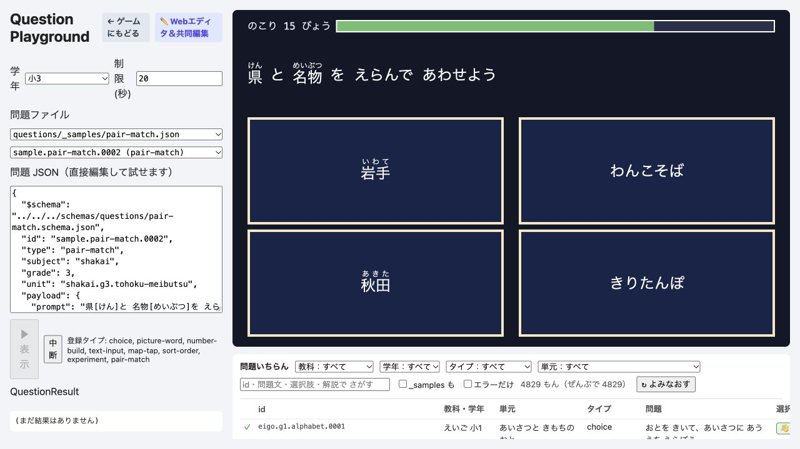

# Walkthrough: pair-match 問題 renderer の本番復旧

## 何を作ったか

- `pair-match` payload schema と、ミス回数で減点する採点関数を追加した。
- 神経衰弱型の裏向きモードと、左右列から選ぶ表向きモードを Preact renderer として追加した。
- 現行 `AbortSignal` 契約へ合わせ、時間切れ・中断時は保留 timer を解除して `score: 0` で即時完了するようにした。
- RubyText、TimerBar、Feedback、48px以上のボタン、focus-visible、ARIA名とprompt関連付けを既存問題枠へ統合した。
- renderer registry、i18n、3問のサンプル、生成 schema、unit/E2E testsを追加した。

## 実画面

- URL: <http://127.0.0.1:4176/playground.html>
- 表向き2ペアのサンプルを表示し、キーボードだけで完答した。
- 結果: `score: 1`, `attempts: 2`, `detail.misses: 0`
- browser console: warning/error 0件
- 6ペア・12カードも960×540の問題枠内に収まることを Playwright で確認した。

## 検査

- RED: renderer 未実装で focused tests が import failure になることを確認
- focused: 2 files / 17 tests passed
- related: 9 files / 100 tests passed
- Playwright: 2 tests passed
- full gate: 183 files / 1,815 unit tests passed
- architecture、schema/manifest生成、curriculum/roadmap/worldmap監査、content/curriculum検証、全型検査、production build、performance budget passed
- mutation: ペア一致条件を反転すると2 testsが失敗し、回帰を検出できることを確認

## レビュー

- Correctness: 2〜6ペア、両モード、減点、下限0、時間切れ、abortをテスト済み。
- Readability: 既存 shared componentsを再利用し、新しい共通抽象は追加していない。
- Architecture: rendererからPhaser、Scene、GameState、保存先へ依存していない。
- Security: payloadをZodで検証し、HTML文字列挿入や外部通信を追加していない。
- Performance: 最大12カードの小さい配列操作と、解放される短時間timerだけを使用する。

## 残課題

なし。学習ロードマップとアニメーションは意図どおり変更していない。
