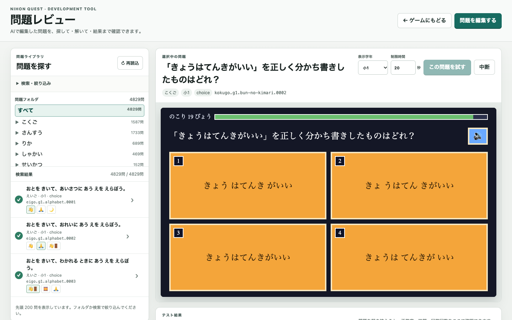

# Walkthrough: AI 前提の Question Playground 再設計

2026-10-30 完了。

## 作ったもの

- Question Playground を「問題を探す → 実際に解く → 結果を確認する」レビュー・ワークスペースへ再構成した。
- フォルダ、検索、絞り込み、問題要約を左の問題ライブラリにまとめた。問題フォルダを主導線にし、検索・絞り込みは初期状態で閉じる。旧 manifest の一覧フォールバックも維持した。
- 選択問題の問題文・教科・学年・タイプ、テスト操作、ステージをひとつのプレビューに集約した。
- 採点結果を「正解 / 時間切れ」、正答度、所要時間、回答回数で確認できるようにした。
- 元ファイル、問題 JSON、登録タイプ、生の `QuestionResult` は削除せず、初期状態で閉じた「技術情報」へ移した。
- 1100px 以下は一覧とレビューを縦積みにし、960×540 基準の問題枠が押しつぶされないようにした。320px ではページ全体の横スクロールがない。

## 開発者導線と公開境界

- ローカルのゲームで開発者モードを ON にすると、メニューに「問題一覧」「問題編集」が出る。
- 開発者モード OFF、または開発ツールを含まないビルドではリンクを渡さない。
- 通常の `pnpm build` は `playground.html` / `editor.html` を生成しない。`VITE_NQ_DEV_TOOLS=1 pnpm build` と `pnpm dev` / `pnpm nrd` だけが両ページを生成する。
- 公開ホストの `?dev` では開発者モードを有効化できない。

## スクリーンショット

1440×900 で、問題探索、選択中の問題、テスト操作、960×540 ステージが同時に判別できることを確認した。アプリ内ブラウザでは、通常幅と狭い幅の両方で選択・解答・結果表示まで操作した。

## 確認したこと

- `pnpm lint`：成功。
- `pnpm check:architecture`：成功。依存境界と Scene 行数上限を維持。
- `pnpm test`：200 ファイル / 1966 テスト成功。
- `pnpm validate:content`：成功。
- `pnpm build`：成功。直後に公開用 `dist/` へ `playground.html` / `editor.html` がないことを確認。
- `VITE_NQ_DEV_TOOLS=1 pnpm build`：成功。両開発ページを生成。
- Playground と問題レンダラーの E2E：20件成功。全件数、8並列、フォルダ、320px、旧 manifest、直リンク、全問題タイプの操作を含む。
- 開発者メニュ E2E：はじめから → 開発者モード ON → メニューで両リンクを確認。
- 最終スモーク E2E：翻訳辞書の欠落警告なし、レビュー構造、開発者メニュの3件成功。
- ミューテーション：開発者リンク表示を一時的に無効化すると focused unit test が失敗し、復帰後に27件成功することを確認した。

## 5軸レビュー

- correctness：問題契約・レンダラー・問題データは変更せず、既存の直リンクと実行結果を維持した。
- readability：主動線と技術情報を分離し、新規文言は i18n と RubyText 規約へ集約した。
- architecture：開発ツールは `src/tools/` と Vite 入力に留め、ゲーム本体は URL をメニューへ渡すだけにした。
- security：開発ツールの表示にローカル URL、開発ツール同梱、開発者モード ON の3条件を必須とした。
- performance：4,829問の8並列読込と200件表示上限を維持し、新規依存は追加していない。

## 残課題

今回のスコープ内の残課題はなし。問題内容の学術レビュー323ファイルは既存の運用課題で、この UI 変更では扱っていない。
