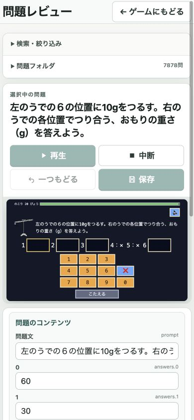

# 問題ビューの完成分統合と全E2E確認

## 統合内容

専用ブランチ: `codex/integrate-question-view-completed`。最新共有版 `b02ab170` を統合したコミットは `98b40145`。

- 算数の小1〜小6図解、ランダム計算、8択、画面内テンキー、読み入力の完成分を統合。
- 小1漢字筆記判定・細い入力線・ペン座標の補完と中断復帰（元コミット `49f7f6a3`、`a915be7a`）。
- 長文の単一回答を独立行に配置し、理科の複数欄の重複説明と余分な全角空白を整理。位置番号・単位・図・正解を維持。
- 問題バンクの遅延読み込みと起動JSONの重複削減。契約・保存形式・性能予算は維持。
- 共有版の小1訓読み、小2〜小4の音読み・訓読み、小6教材復元も取り込み済み。

## 全件実行で検出した失敗

| 検査                 | 修正                                                       |
| -------------------- | ---------------------------------------------------------- |
| 攻撃後の待機復帰     | 移動演出のPromiseとは別に終わるスプライトの復帰を待つ      |
| 歩行後の地図表示     | キーを離した後、歩行完了を待って地図を開く                 |
| 石段を1歩ずつ移動    | 1フレーム未満のキー押下を避け、歩行開始時に離す            |
| 漢字の縮小座標       | 細線の座標丸めを画面上の約1px以内で照合する                |
| リンゴロンの待機描画 | 既存のアニメーション検査と同様に検査ページを前面にする     |
| 理科の入力欄の大きさ | 説明の繰り返しと全角空白を除き、入力行の折り返しを解消する |

失敗をskipで除外したり、理科の縮小率基準を下げたりしていない。CIの開発画面検査に漢字筆記と全学年図解を含め、追加件数に合わせジョブ上限を45分とした。

## 検証

- `pnpm check:full`: lint、architecture、教材・カリキュラム監査、全型検査、build、性能予算まで成功。
- 単体テスト: 268ファイル、2443件成功。
- 初回の `pnpm test:e2e:full`: 全849件を省略なく実行、843成功・6失敗。上記6件を修正。
- 修正した6ファイルのE2E52件: 51成功。残った理科1件は回答行を追加修正して成功。
- 共有版同期後、追加39件を含む関連207件がすべて成功。最新のE2E一覧は888件で、未実行ケースなし。
- 最新の全問題監査も成功。7902問を960×540、720×405、390×219、844×390で描画し、表示領域ゼロ・文字の内部クリップを含め検査。
- Android Chromium相当のスマホ検査21件成功。回転、入力中の高さ変更、時計のタップ、一覧幅と820px境界を確認。
- 実ブラウザで余りあり割り算と理科の入力・正解判定を操作し、390px幅の表示とコンソールエラーなしを確認。
- 性能: 初期JS 421543 gzip bytes、初期JSON 2373573 raw bytesで既存予算内。

## 検証環境の限界

Mac上のPlaywright WebKitは、公式バイナリの再インストールと通常ウィンドウ起動でもページ作成時にsegmentation fault。WebKitの合否はLinux CIの `mobile-layout` で確認し、その成功までマージしない。

スマホ・タッチペンの実機、子どもの実筆跡による認識感度の校正は未実施。古いPR #17・#21は後続実装で置換済みで、この統合に混ぜていない。
