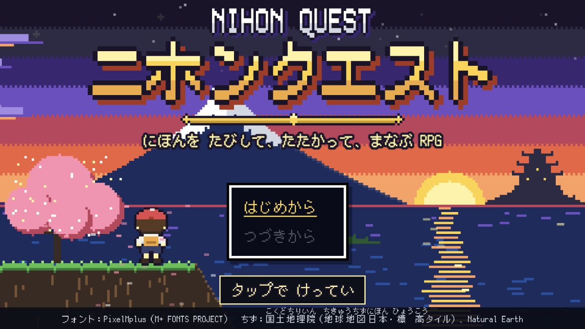

# Runtime integration walkthrough

## 統合したもの

- フィールド操作を pure router と runtime dispatch に集約し、同一フレームのキー／タップ重複を一回化した。
- production event runtime の `choice` 契約と map-object movement を維持したまま、イベント実行経路へ統合した。
- 一時 UI、カメラ効果、タイマー等を abort-safe な effect scope に所有させ、完了・中断・Scene shutdown で一度だけ解放するようにした。
- ランダム遭遇を deterministic policy に移し、遷移直後抑制、戦闘後 cooldown、連続外れ pity、地域／地面／解放条件を統合した。
- 戦闘演出を順序付き presentation runtime へ移し、終了後の遅延 callback を抑止した。

## 競合と追加リスクの解消

- production event runtime の `choice` と movement port を保持し、旧ブランチ側の重複 runtime を採用しなかった。
- `d5cc01f5` は全体を merge せず、選択肢範囲検証、reward 閾値重複検出、教材 JSON の教科別 chunk 分割だけを現行契約へ移植した。
- effect scope 導入後、マップ遷移・イベント warp・敗北復帰が同じ flow scope を受け取るよう port 生成を flow 内へ移した。
- encounter policy と既存 encounter lifecycle を同居させ、イベント床では歩数だけ進めて遭遇 interval を消費しないことをテストした。
- 実ブラウザ検証で、会話直後の250msロックがメニュー操作まで拒否する回帰を発見し、メニューを統合前と同じロック条件へ戻した。
- E2E の新規ゲーム補助は固定 sleep ではなく `data-input-ready=true` を待つようにした。

## 検証結果

- lint / Prettier: OK
- architecture boundaries / Scene budgets: OK
- unit: 151 files / 1,574 tests passed
- content: 47 areas / 542 monsters / 462 items / 37 skills / 86 question files, OK
- production build: OK
- relevant browser E2E: battle 7 + enemy knockout 2 + overworld 12, all passed
- largest curriculum chunk: 529.45 kB（分割前の shared curriculum chunk を解消）
- Graphify code-only graph: 41,188 nodes / 50,291 edges

## 最新プレビュー

`http://127.0.0.1:4174/?resetSaves=1` をアプリ内ブラウザで開き、再現可能な初期画面と console の error / warning 0件を確認した。

## 残課題

- コンテンツ検証の情報メッセージとして、学術レビュー81ファイルが承認待ち、任意画像602件と任意問題アセット2件が未配置。いずれも既存のフォールバック対象で、この統合の失敗ではない。
- push / deploy / 共有ブランチへの merge は未実施。
